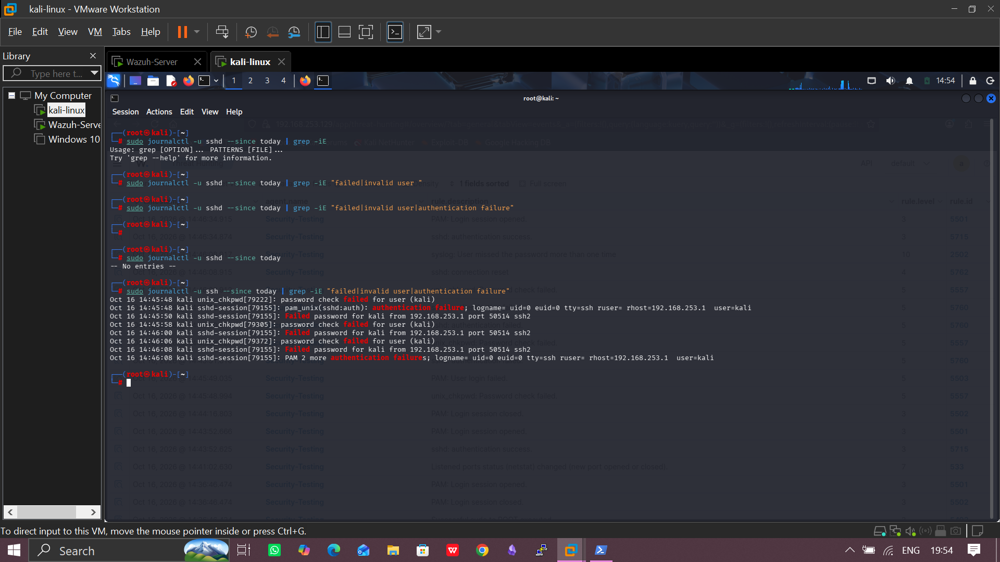

# 02: Visibilty and Telemetry

## Objectives

Simulate two scenarios in the lab: failed login activity and a network connection investigation. Investigate the resulting activity in Wazuh, compare visibility across available telemetry sources, and determine whether the two activities can be correlated into one incident narrative.

## Steps

### Deploy and verify a functional Wazuh environment with connected Windows and Linux log sources.

I deployed wazuh on the ubuntu server (from the previous three vm lab environment) using the quick installation guide available on wazuh website then I connected the kali linux machine and windows machine as agents on the wazuh server.

| Role | System | Telemetry |
| --- | --- | --- |
| Linux victim | Kali (wazuh agent) | Default logs; Auditd |
| Windows victim | *Windows Home:* Lamie-LAPTOP (wazuh agent) | Default Windows event logs; Sysmon |
| SIEM | Wazuh | Collects all agent logs |

**Attack story**

- **Linux:** I attempted to login into the Kali machine by brute-forcing SSH, I was able to log in successfully, then I made an outbound connection and downloaded a file.
- **Windows:** I tried Win+L to lock my windows machine then I tried to log in by using different wrong passwords, I eventually succeeded by trying the correct password after a couple of tries, made an outbound connection and downloaded a file.

**Investigation questions**

- Failed logins: When did they start, did Wazuh log any alert; how many, over what time frame, which accounts, which source IPs, was there a later success, and what was the gap?
- Outbound connection: what was the first sign after login, did Wazuh log alerts, what destination IP and port, which process, which file, and can the logs alone prove it?
- Timeline: can failed logins, successful login and outbound connection be rebuilt in order?
- Relation: do the IPs match, is the account the same, does one session ID link both, how close in time are they, and did the process spawn from the login session?

Each question is answered twice: one with default logs, another with the enriched telemetry (Auditd on Linux, Sysmon on Windows).

The difference between centralized logging and telemetry generation: Telemetry generation is where evidence gets created (Windows event logs, Sysmon, etc.), and centralized logging is where it gets collected and kept (SIEM). 

Compare default Windows logging with Sysmon-enriched telemetry.

Compare default Linux logging with Auditd-enriched telemetry.

Correlate multiple activities into a coherent incident timeline.

Identify visibility gaps and recommend practical telemetry improvements.

Communicate technical findings to both analysts and management.
