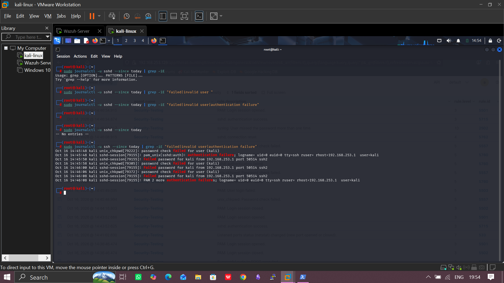

# 02: Visibilty and Telemetry

## Objectives

Simulate two scenarios in the lab, investigate the resulting activity in Wazuh, compare visibility across available telemetry sources, and determine whether the two activities can be correlated into one incident narrative.

## Steps

### Deploy and verify a functional Wazuh environment with connected Windows and Linux log sources.

I deployed wazuh on the ubuntu server (from the previous three vm lab environment) using the quick installation guide available on wazuh website then I connected the kali linux machine and windows machine as agents on the wazuh server.

The difference between centralized logging and telemetry generation.

Telemetry generation is where evidence gets created, and centralized logging is where it gets collected and kept. Telemetry generation is the creation of the raw data on the endpoint or device itself. It’s what Windows, Sysmon, and EDR agents write out about what’s happening: a process started, a user logged on, etc.

Centralized logging is collecting that data from all your sources and moving it to one place, like a SIEM (Wazuh, Splunk), where it’s stored, searchable, and correlated.

Compare default Windows logging with Sysmon-enriched telemetry.

Compare default Linux logging with Auditd-enriched telemetry.

Correlate multiple activities into a coherent incident timeline.

Identify visibility gaps and recommend practical telemetry improvements.

Communicate technical findings to both analysts and management.
