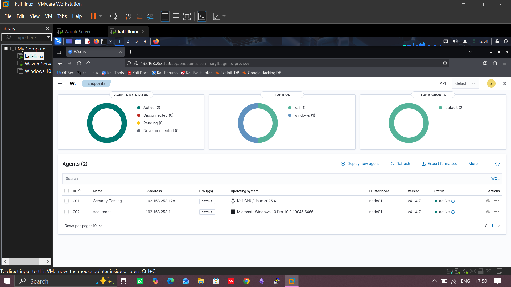
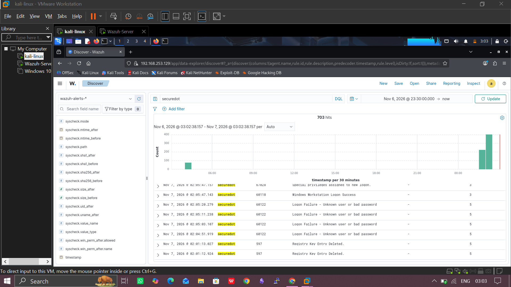
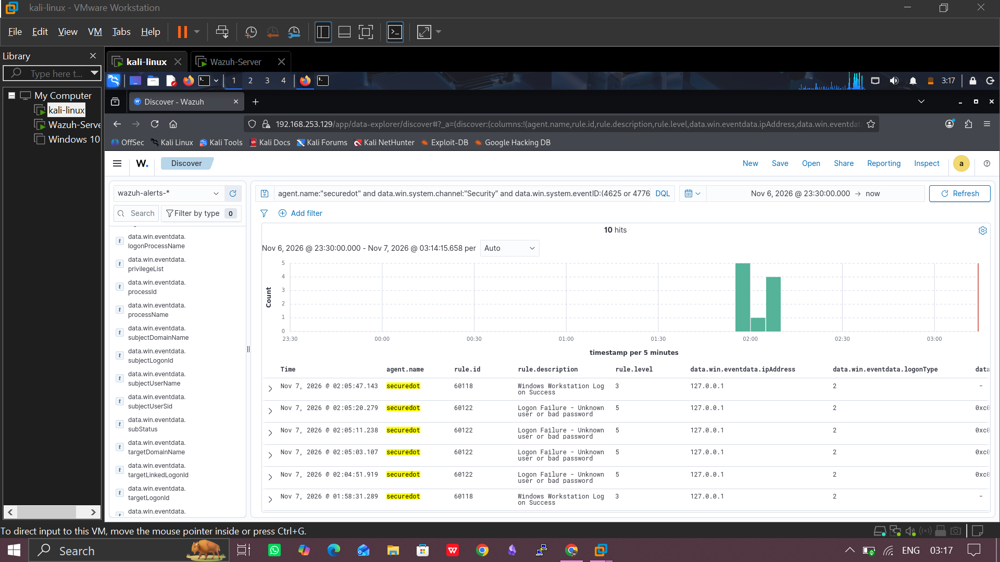
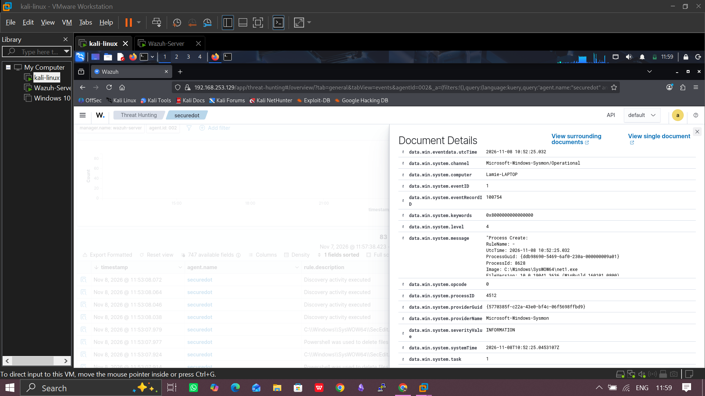
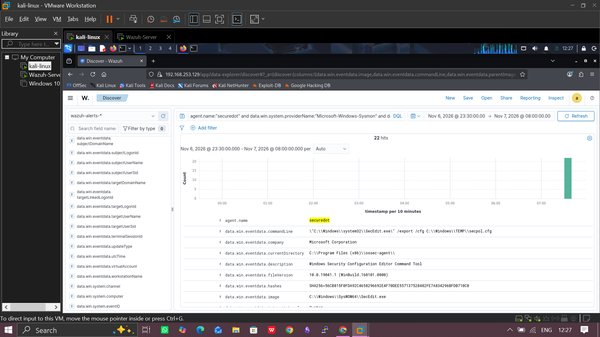
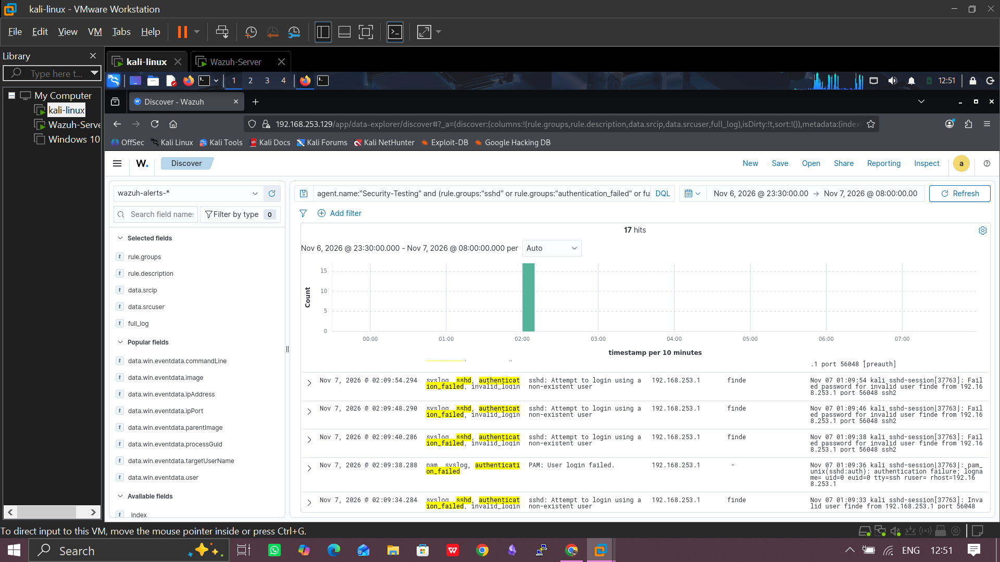
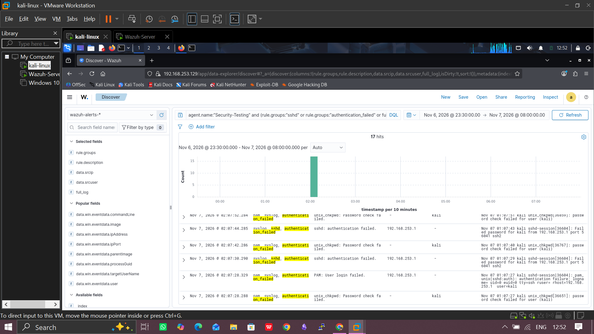

# 02: Visibilty and Telemetry

## Executive summary

**Scope.** Two scenarios were run in a controlled lab: a Wazuh server (`192.168.253.129`), a Windows 10 host with Sysmon (`securedot`) and a Kali Linux host with auditd (`Security-Testing`). Scenario 1 generated repeated failed authentication attempts. Scenario 2 generated outbound network activity followed by a file download, so both could be linked in one chain. The goal was to test whether default and enriched telemetry can answer who, what, when and from where.

**Reconstructed narrative.** 4 failed logons were generated against the Windows and Linux hosts through SMB, local logon, SSH and sudo. They were followed by a successful login after about 56s. The Windows user ran `nslookup` and `curl.exe`, which produced a DNS query for example.com, an HTTPS connection and the creation of `lab_download.html` with SHA256 hash. The same sequence was repeated on Kali using `curl` and `wget`.

**Major findings**
- Failed logons were recorded in default logs on both systems (Windows 4625/4776, Linux `auth.log` and journald), including account, source and failure reason. Wazuh raised [authentication failure/brute-force] alerts.
- The outbound activity could be attributed to a specific process, command line, user, destination and file only through Sysmon (Windows) and auditd (Linux). Defaults showed no network or process evidence.
- Matching process identifiers and file hashes across Sysmon, FIM and manual hashing tied the connection to the downloaded file.

**Operational issues found during testing**
- Kali and Wazuh clocks were out of sync with Windows by about five hours, which would have broken the timeline. This was corrected before the final run.
- The Wazuh agent on Kali was not configured to read `audit.log`, so auditd evidence stayed local until the log source was added.
- The auditd `connect` rule produced heavy noise from local socket calls and needed filtering by executable.

**Confidence.** High for the failed-login activity, since multiple independent sources agree. Moderate to high for the outbound and download chain, because it depends on configuration we added.

**Key gaps**
- Windows process creation (4688) and network connection (5156) auditing are off by default.
- No default outbound visibility on Linux.
- Sysmon records no authentication outcomes and no file hash in Event 11.
- No DNS name attribution on Linux and no flow data.
- Agent connectivity and log-source collection were not monitored.

## Incident Scope and Questions

I investigated two linked scenarios on Linux and Windows host, to decide whether a failed-login attack and a later outbound download form one incident.

1. **Failed login activity:** generate multiple failed authentication attempts.
2. **Network connection investigation:** generate outbound network activity and analyze the telemetry.

**Attack story**

- **Linux:** I attempted to login into the Kali machine by brute-forcing SSH, I was able to log in successfully, then I made an outbound connection and downloaded a file.
- **Windows:** I tried Win+L to lock my windows machine then I tried to log in by using different wrong passwords, I eventually succeeded by trying the correct password after a couple of tries, made an outbound connection and downloaded a file.

**Systems in scope**

| Role | System | Telemetry |
| --- | --- | --- |
| Linux victim | Kali `Security Testing` (Wazuh agent) | Default logs; Auditd |
| Windows victim | Windows Home: `securedot` (wazuh agent) | Default Windows event logs; Sysmon |
| SIEM | Wazuh | Collects all agent logs |

**Investigation questions**

- Failed logins: When did they start, did Wazuh alert, how many, over what time frame, which accounts, which source IPs, was there a later success, and what was the gap?
- Outbound connection: what was the first sign after login, did Wazuh alert, what destination IP and port, which process, which file, and can the logs alone prove it?
- Timeline: can failed logins, successful login and outbound connection be rebuilt in order?
- Relation: do the IPs match, is the account the same, does one session ID link both, how close in time are they, and did the process spawn from the login session?

Each question is answered twice: one with default logs, another with the enriched telemetry (Auditd on Linux, Sysmon on Windows).

| Component | Detail |
| --- | --- |
| Wazuh dashboard | Ubuntu server IP: 192.168.253.129 |
| Kali Linux | **Hostname**: `Security Testing` **I**P**:  192.168.253.128 ****OS version:** Ubuntu 24.04.5 **Agent version:** Wazuh agent |
| Windows agent | ***Hostname**: securedot, **IP**: 192.168.253.1, **OS Version**: Windows 10, **Agent version**: Wazuh agent* |

**Auditd configuration.** Auditd runs on the Linux agent and its logs are forwarded to Wazuh. The execve audit data shows it records process execution and arguments. Custom auditd rules alert on `wget` execution. 

**Sysmon configuration.** Sysmon on the windows endpoint and forwards logs to Wazuh. sysmon event ID 1, 11, 3 monitor process creation, filecreation, and network connection respectively.

## Methodology

I ran the attack twice per scenario chain, then investigated the activity from wazuh and compared what default logging and the enhancement showed.

**Windows order of testing**

1. I locked the windows with Win+L
2. Ran a local brute-force against `securedot`.
3. Successful login with the right password.
4. From that session, performed an outbound connection and then downloaded a file with `curl.exe`.

**Windows action log**

| Step | Action | Host | User | Time |
| --- | --- | --- | --- | --- |
| 1 | Failed authentication | Local | user1 | Nov 7, 2026 2:04:51 |
| 2 | Successful local login | securedot | administrator | Nov 7, 2026 2:05:47 |
| 3 | Outbound connection | bootcampwin | administrator | Nov 7, 2026 2:06:53 |

**Linux order of testing**

1. Brute-forced SSH against kali from Windows.
2. SSH login bruteforce with invalid user and then kali user.
4. Logged in over SSH with the recovered password.
5. From that session, performed an outbound connection and then downloaded a file with `curl and wget`.

**Linux action log**

| Step | Action | Host | User | Time |
| --- | --- | --- | --- | --- |
| 1 | SSH brute force | Windows to kali | attacker, target kali | Nov 7, 2026 2:07:18 |
| 2 | Successful SSH login | `securedot` | `security testing` | Nov 7, 2026 2:10:23 |
| 3 | `wget` download | `securedot` | `security testing` | Nov 7, 2026 2:18:32 |

## Timeline Reconstruction

**Windows timeline**

| Time | Host | User | Activity | Evidence source |
| --- | --- | --- | --- | --- |
| Nov 7, 2026 2:04:51 | securedot | administrator | Local brute-force | Windows log |
| Nov 7, 2026 2:05:47 | securedot | administrator | Successful local login via guessed credentials | Windows log |
| Nov 7, 2026 2:06:53 | securedot | administrator | Execution of `curl.exe` to download a file | Sysmon log |

**Analysis**

- The brute-force burst (about 4 failed attempts) from the local system fits inside one short window ending at the successful login within roughly 55 seconds.
- The login at 2:05:47 attributed to `administrator`, the same account targeted by the failed attempts.
- The `curl.exe` at 2:06:53 comes 66 seconds after the login, consistent with acting straight after gaining access.

**Linux timeline**

| Time | Host | User | Activity | Evidence source |
| --- | --- | --- | --- | --- |
| Nov 7, 2026 2:07:18 | windows | kali | SSH brute force with fake user and password from an external source (192.168.253.1) | Journald |
| Nov 7, 2026 2:09:28 | windows | kali | SSH brute force with real user and fake passwords from an external source (192.168.253.1) | Journald |
| Nov 7, 2026 2:10:23 | windows | kali | Successful SSH login via guessed credentials | Journald |
| Nov 7, 2026 2:18:32 | windows | kali | Execution of `wget` to download a file | Auditd |

**Analysis**

- The ssh brute-force burst, about 8 failed attempts (4 with fake user and another 4 with real user) fits inside one short window ending at the successful login.
- The login at 2:10:23 is attributed to `kali`, the same account targeted by the failed attempts.
- The `wget` at 2:18:32 comes 8 minutes after the login.

## Telemetry Analysis

### Windows default logs

- *Failed and successful logins.*

4 failed login events were recorded in wazuh dashboard, after which a normal logon was recorded, which was succeeded by a special logon event. The special logon was raised because the user who logged in has administrative privilege.

*failed logins as alerted by wazuh*

*logon type and ip address*

- *Outbound connection*

Windows event viewer, with the default config, does not log network connection by, unless explicitly configured to do so (IDs 4688 and 5156)

#### Sysmon

- *Failed and successful logins*

Sysmon does not monitor authentication activities, and so did not raise an alert for the failed and successful login activities.

- *Outbound connection*

Shortly after the login activity, alerts were raised about an outbound connection over http. Sysmon logged the process creation, outbound network connection, and file creation activity.

### Default Linux logs

- *Failed and successful login*
Wazuh raised alerts from the default SSH and PAM logs. Rules 5760 (SSH authentication failed), 5503 (PAM login failed) and 5763 (SSH brute force) cover the attack, and rule 5501 (PAM login session opened) covers the success.

*failed authentication with fake user*

*failed authentication with kali user*

Default Linux logs fully covered the login stages but were blind to the download; Auditd closed that gap. 

Compare default Windows logging with Sysmon-enriched telemetry.

Compare default Linux logging with Auditd-enriched telemetry.

Communicate technical findings to both analysts and management.
