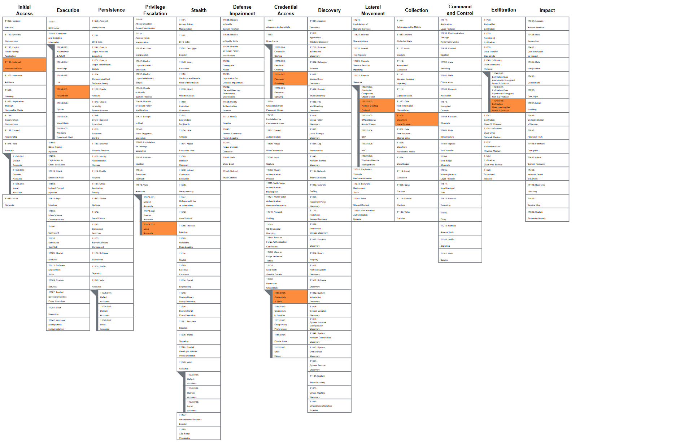

# 04 - RDP Compromise and MITRE ATT&CK Mapping

## Objective

Develop a realistic cyberattack scenario involving RDP and map the attack flow using the updated MITRE ATT&CK Enterprise Matrix. Steal confidential corporate data and delay detection by erasing evidence of the intrusion.

Brute force > 
Intern RDP login > 
Password in PDF > 
Manager RDP login > 
PowerShell exfil > 
Log clearing

Apply threat intelligence, Wazuh log analysis, and custom detection engineering to investigate and detect selected activities.

## Incident Story

An external attacker found an exposed Remote Desktop Protocol (RDP) service on a corporate Windows endpoint. They brute-forced the password of a low-privilege local account, Intern, and logged in.

On the Intern desktop, the attacker found an unencrypted file, Employee_Onboarding.pdf. It held the default password for a newly created IT Manager account (Kevin) that has local administrator rights.

The attacker opened a new RDP session as the Manager account and found unencrypted sensitive data, Trade Secret.docx. They opened PowerShell and ran a custom TCP socket script that streamed the file to a Netcat listener on their own machine. This avoids browser monitoring.

Before disconnecting, the attacker cleared the Windows Security and Sysmon event logs.

## Scope

### MITRE ATT&CK Mapping

I mapped the attack to the updated MITRE ATT&CK Enterprise Matrix using ATT&CK Navigator. The layer has nine techniques, in attack order. A technique and its sub-technique count as one step.

**Navigator layer:** 

This is a mapping of a hypothetical scenario. Not every technique has log evidence in my lab.

### Techniques in attack sequence

| # |	Tactic	| ID	| Technique |
| --- | --- | --- | --- |
| 1	| Initial Access	| T1133	| External Remote Services (exposed RDP)| 
| 2 |	Credential Access	| T1110.001	| Brute Force: Password Guessing |
| 3	| Lateral Movement	| T1021.001	| Remote Services: Remote Desktop Protocol |
| 4	| Credential Access	| T1552.001	| Unsecured Credentials: Credentials In Files |
| 5	| Priv. Esc. / Persistence	| T1078.003	| Valid Accounts: Local Accounts (Manager) |
| 6	| Collection	| T1005 |	Data from Local System |
| 7	| Execution	| T1059.001	| Command and Scripting Interpreter: PowerShell |
| 8	| Exfiltration	| T1048.003	| Exfiltration Over Unencrypted Non-C2 Protocol |
| 9	| Defense Evasion	| T1070.001 |	Indicator Removal: Clear Windows Event Logs |

