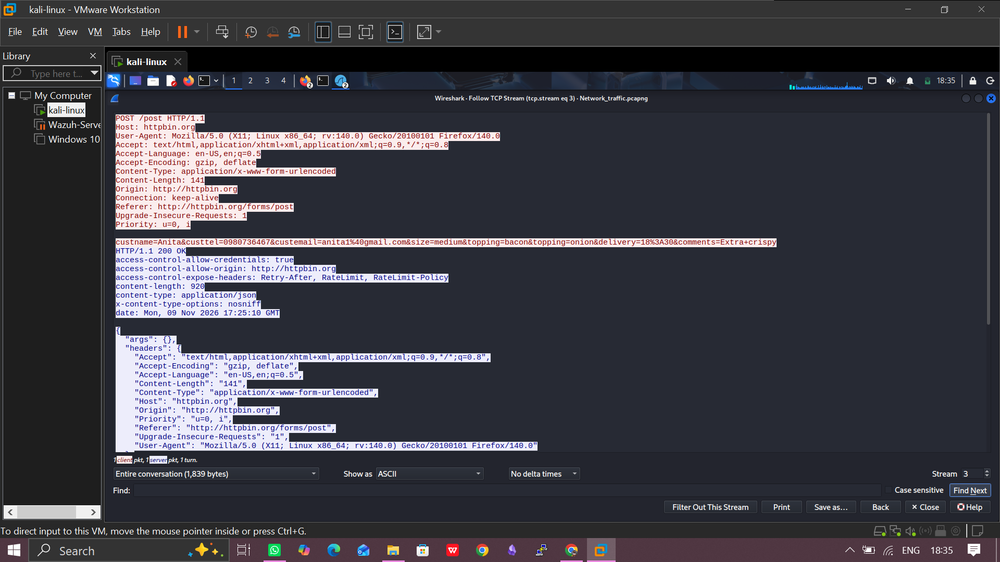
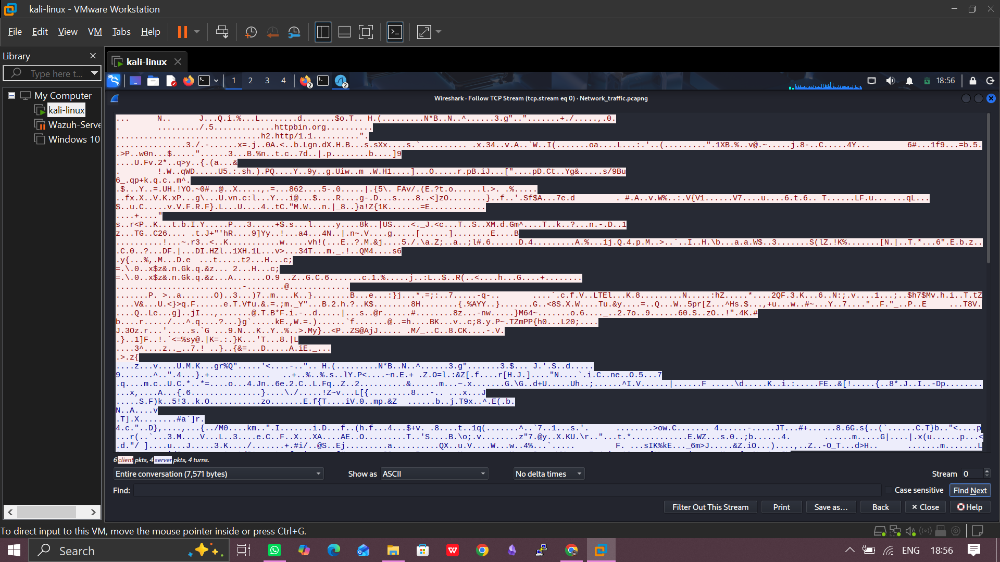

# 04 Network Security Monitoring (NSM)

## HTTP vs HTTPS Traffic Analysis

> **Note:** Only dummy data was typed into the test form. No real personal information was captured.

## Objective

- Show that HTTP sends data in clear text, so anyone capturing the traffic can read it.
- Show that HTTPS encrypts the content, so form data cannot be read.
- Identify the details that remain visible in HTTPS traffic.
- Document the Wireshark filters used and what a SOC analyst should look for.

## Lab Setup

| Item | Details |
|---|---|
| Operating system | Kali Linux |
| Tools | Wireshark, web browser |
| Test site | `httpbin.org/forms/post` (dummy pizza order form) |
| Kali IP | `192.168.253.128` |
| Capture interface | `eth0` |
| PCAP file | `Network_traffic.pcap` |

The test form works on both HTTP and HTTPS, so the same form can be submitted both ways and compared.

- HTTP: `http://httpbin.org/forms/post`
- HTTPS: `https://httpbin.org/forms/post`

## Methodology

1. Open the form on HTTP and on HTTPS.
2. Fill both forms with dummy details (customer name, email, phone, and so on). Do not submit yet.
3. Open Wireshark and select the network interface.
4. Set the **capture filter** `host httpbin.org` so only traffic to and from the test site is recorded.
5. Start the capture, then submit the HTTP form and the HTTPS form.
6. Stop the capture and save a single PCAP file.

### Capture filter vs display filter

- `host httpbin.org` is a **capture filter**. It is set before capturing and decides what gets recorded.
- The filters in the sections below are **display filters**. They are applied to the saved PCAP to isolate HTTP or HTTPS traffic.

### About the PCAP

One file covers both activities. It contains the TCP handshake and the TLS Client Hello for each submission. It does **not** contain DNS traffic, because the capture filter excluded it.

---

## Activity 1: HTTP Analysis

**Goal:** Show that HTTP exposes everything in clear text.

### Key details

| Detail | Value |
|---|---|
| Source IP (Kali) | `192.168.253.128` |
| Destination IP (httpbin.org) | `3.221.253.123` |
| Source port | `47986` |
| Server port | `80` |
| Protocols | TCP, HTTP |

### Display filters used

| Filter | Purpose |
|---|---|
| `http` | Shows all HTTP packets |
| `tcp.port == 80` | Shows all traffic on port 80 |
| `http.host == "httpbin.org"` | Shows HTTP going to the test site |
| `http.request.method == "POST"` | Shows the form submission |
| `urlencoded-form` | Shows the form fields inside the POST |
| `http.response` | Shows the server's replies |
| `tcp contains "[dummy value]"` | Finds the typed dummy data in the packets |

### What is visible (clear text)

- The POST request and its path: `POST /post HTTP/1.1`
- The Host header and other headers
- The form data that was typed: name, email, phone and the rest
- The server's reply and status code: `[HTTP/1.1 200 OK]`

### What is not visible

- Who the real person is
- What the server does with the data after receiving it

### Evidence

Right-click a packet, then **Follow > HTTP Stream**, to read the whole conversation.

---

## Activity 2: HTTPS Analysis

**Goal:** Show that HTTPS encrypts the content, while some metadata remains visible.

### Key details

| Detail | Value |
|---|---|
| Source IP (Kali) | `192.168.253.128` |
| Destination IP (httpbin.org) | `3.221.253.123` |
| Source port | `35926` |
| Server port | `443` |
| Protocols | TCP, TLS |
| TLS version | TLS 1.3 |
| Cipher suite | `TLS_AES_128_GCM_SHA256 (0x1301)` |
| Server name (SNI) | `httpbin.org` |
| Certificate issuer | Not visible in this PCAP (TLS 1.3 encrypts the certificate) |

### Display filters used

| Filter | Purpose |
|---|---|
| `tls` | Shows all TLS packets. Packets marked *Application Data* are the encrypted data |
| `tcp.port == 443` | Shows all traffic on port 443 |
| `tls.handshake.type == 1` | Shows the Client Hello (start of the TLS handshake) |
| `tls.handshake.type == 2` | Shows the Server Hello |
| `tcp.port == 443 && tcp contains "[dummy value]"` | Should find nothing, because the data is encrypted |

### What is visible

- The TCP handshake
- Client Hello: TLS versions, cipher suites and the server name (SNI)
- Server Hello: the version and cipher the server picked
- IP addresses, ports, packet sizes and timing

### What is encrypted

- The URL path
- Headers
- The certificate (in TLS 1.3)
- The form data
- The server's reply

### Evidence

---

## HTTP vs HTTPS Comparison

| Item | HTTP | HTTPS |
|---|---|---|
| Port | 80 | 443 |
| Encryption | None | TLS |
| Form data readable? | Yes | No |
| Server name visible? | Yes, in the Host header | Yes, in the SNI |
| Server identity checked? | No | Yes, with a certificate |
| Main Wireshark filter | `http` | `tls` |

**Why HTTPS is safer:** `HTTPS is safer as it ensures that information is encrypted while in transit. Now this doesn't mean that the site itself is safe, it only helps to ensure that the site is secure and encrypted over the network.`

---

## SOC Analyst Perspective

### What to look for in HTTP traffic

- Passwords or personal data sent in clear text
- Odd User-Agents, such as scripts or scanners (`curl`, `sqlmap`)
- Requests to suspicious sites, or straight to an IP address
- Downloads of `.exe` or script files

### What to look for in HTTPS traffic (even though it is encrypted)

- The server name (SNI) and the reputation of the IP
- Bad certificates: self-signed, expired or with the wrong name
- Old TLS versions or weak ciphers
- Regular, repeated connections to one rare host (possible beaconing)

---

## Security Risks and Recommendations

| Risk | Recommendation |
|---|---|
| HTTP shows data in clear text. Anyone on the network can read it | Use HTTPS everywhere and redirect HTTP to HTTPS |
| Attackers can change HTTP pages on the way | Turn on HSTS |
| Old TLS or weak ciphers | Use TLS 1.2 or 1.3 only |
| Bad or expired certificates | Use certificates from a trusted CA and watch the expiry |
| Encrypted traffic can hide attacks | Monitor the SNI, certificates, traffic patterns and logs |

## Disclaimer

This work was done in a controlled lab environment against a public testing service (`httpbin.org`) using dummy data, for educational purposes only.
